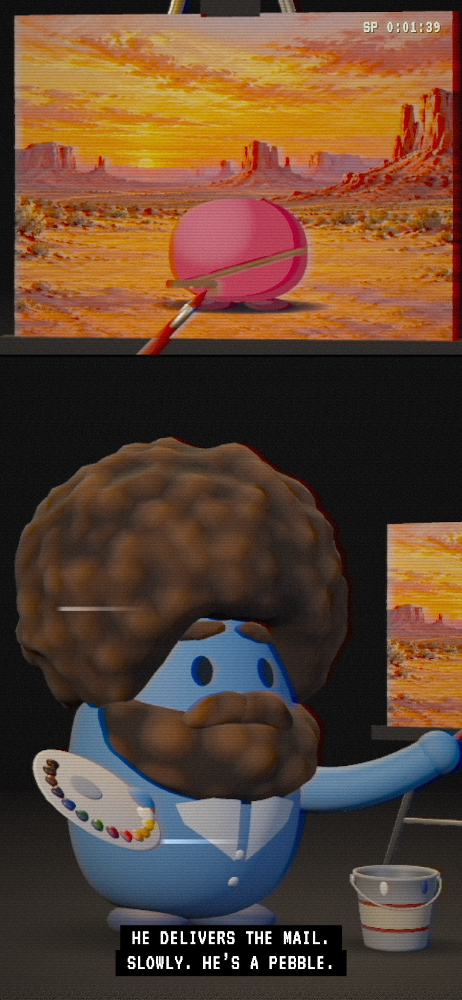

# The Joy of Pebbling, with Cobb Moss

> We don't make mistakes, just happy little sediments.

[](https://davidyen1124.github.io/joy-of-pebbling/)

**Tune in: <https://davidyen1124.github.io/joy-of-pebbling/>**

A fan-made parody. Not affiliated with Bob Ross Inc., PBS or Turnstone.

## What is this?

It's a public-television painting show that never aired, on a tape that has been watched too many times.

The host is Cobb Moss, a blue [Turnstone](https://myturnstone.ai) Pebble with an enormous afro and a beard. He stands at an easel and paints, stroke by stroke, while you watch: first a landscape, then a happy little Pebble to live in it. Every episode is a different Pebble, with a different shape, colour, haircut and job. When he has signed it, the credits roll and the next one starts.

The page is that one picture and nothing else. There is no feed, no sign-up and no way to lose. In Cobb's words: "for the next little while, nothing bad is going to happen."

| He signs every one | Viewer Mail |
|---|---|
|  |  |

Every picture here is a real screenshot of the site.

## How to watch

1. Press play. A browser won't let a page make noise until you have touched it, so the programme waits on its title card. (A browser that already trusts the page skips this and simply starts.)
2. Watch. An episode runs about three minutes.
3. Move the mouse, or tap, and a strip of controls comes across the top: **Pause**, **Speed**, **Next**, **Sound**, **Request**, **Keep**. It goes away again after about three seconds. A click on the picture pauses it, as on any video.
4. **Request** opens Viewer Mail. Choose a colour, a shape, a job and a haircut, and Cobb paints that Pebble next. There are 424,800 to choose from. (Pick "no hair at all" and the form stops asking what colour the hair is. Somebody thought about that.)
5. **Keep** saves the painting as a PNG, for the fridge.

Keys: space or `k` pauses, `f` changes speed, `n` or the right arrow is the next Pebble, `m` is sound.

On an upright phone there is no room for Cobb and his canvas side by side, so the picture is cut in two: the canvas across the top, Cobb underneath, reaching for it.

<p align="center">
  
</p>

## An episode

Title card, hello, then the landscape from the top down. Each band of it (sky, mountain, water, ground) is blocked in soft with the big brush and then gone over with its own tool: criss-crosses for sky, the knife for a mountain, taps for foliage. Then he washes the brush in a bucket of thinner and beats it dry on the leg of the easel.

Then the Pebble: shadow, feet, body, the dark side, clothes, arms, hair, hat, eyes, whatever he holds. Sometimes Cobb drops some paint, which is not a mistake, and which becomes a second, smaller Pebble before the end. He signs it in red.

The credits list a pebble wrangler (Sandy Shore) and somebody in charge of brush beating (Dustin Gravel). It is a PEBBLEVISION 49 production, from Gravel Pit, Indiana, copyright 1987.

## Things Cobb says

He is gentle, he is sincere, and he has only ever known rocks.

| While he is | He says |
|---|---|
| painting a mountain | "A mountain is only a pebble that believed in itself." |
| painting a mesa | "A big mesa. That's Spanish for table. So it's a rock, for table." |
| washing the brush | "It's the only violence on this programme." |
| painting the feet | "Feet. Pebbles have feet. Please don't write in." |
| giving a cowboy his hat | "A ten-gallon hat. He's a two-ounce pebble. It's a statement." |
| giving a DJ headphones | "Headphones. He has no ears. Don't tell him." |
| cutting a bowl cut | "A bowl cut. Somebody loved him enough to do this at home." |
| dropping paint on the canvas | "That's alright. We don't make mistakes here. Just happy little sediments." |
| signing it | "Sign it, so they know who to blame." |
| saying goodbye | "Happy pebbling, and rock bless, my friend." |

The whole script is in [`src/script.js`](src/script.js). Counting every way of filling in a blank, it comes to 403 lines.

## FAQ

**Is that Bob Ross?**
No. That is Cobb Moss, and he is a rock. The resemblance is the whole joke. This is a fan-made parody and nobody official has anything to do with it.

**Why is every Pebble called Mason, Pearl or Stoney?**
Cobb's voice is recorded ahead of time, one line at a time, and a free ElevenLabs month paid for 70 of his 403 lines. Those 70 make three complete episodes (Mason the Mail Carrier, Pearl the Rock Star, Stoney the Ballerina), plus four lines vague enough to do for any haircut, any hat, anything held and any friend. So with the sound on, he only paints Pebbles whose names he can say. Turn the sound off and there are 47 names.

**I asked for a pirate and he made no pirate jokes.**
He has pirate jokes. He has not recorded them. A request is still spoken from hello to goodbye, but with the lines he has, so the hat gets "And a hat. Right on top. That's where hats go." Turn the sound off and the jokes are all there in the captions ("A pirate. He sank straight away, but he had a wonderful time."), which is the only time anything is shown that is not said.

**Why does Next keep giving me the same three Pebbles?**
Same reason. With the sound on, Next goes round the three episodes he has recorded in full. With the sound off there is nothing to miss, so Next is simply another Pebble.

**He stopped talking when I fast-forwarded.**
Nobody talks at 2×. He keeps painting, and the captions keep up.

**Why does the picture look like that?**
The tape has spent thirty years in a cardboard sleeve. The colour smears sideways, the lines don't quite line up, and there is a tear along the bottom where the heads switch. All of it is one shader. Tracking cannot be adjusted.

**My iPhone is on silent and I can hear him anyway.**
On purpose. A page that only uses Web Audio is taken for a game and hushed by the ringer switch. This page tells Safari it is a programme, to be heard as a video is (`navigator.audioSession` in `src/audio.js`; Safari 16.4 and later).

**Does he really beat the brush that fast?**
Twenty-two strikes in under two seconds, same as the real programme. It was measured. See [Sound](#sound).

**Can I send somebody a particular Pebble?**
Yes. `?ep=427` is always the same episode, because the number seeds everything. `?j=pirate&h=beehive&hc=pink` asks for one by description. The address tidies itself up as soon as the programme moves on.

## What's inside

- **The picture.** Cobb, his easel, his palette and his brushes are a [three.js](https://threejs.org) scene. The canvas on the easel is a real 2D canvas that gets painted in real time. The whole thing is rendered small and pushed through the tape shader ([`src/vhs.js`](src/vhs.js)).
- **What the station lays over it.** Closed captions (white capitals on black), each paint's name in yellow as he first reaches for it, his name when he says hello, the credits, and the tape machine's read-out in the corners. Nothing else is on screen.
- **The painting.** Nothing is faded or wiped in. Each part of the picture exists finished, off screen: a band of the landscape, or one part of the Pebble on a clear layer. [`src/painter.js`](src/painter.js) plans strokes over the part (rows, criss-crosses, knife pulls, taps) and gives every point on them a time. As the clock passes each point it stamps a bristle-shaped mask there and lets the finished image through. Where the latest stamp is, is where the tip of the brush is, so the 3D arm simply follows it. A landscape band is done twice, once from a blurred copy and once from the sharp one, which reads as blocking in and then detail.
- **The director.** [`src/show.js`](src/show.js) writes the episode (which lines, which shots, how long) and then runs it beat by beat. Time is set by Cobb's voice: a beat lasts as long as its lines take to say, and the brush is given that long to do its part.
- **The camera** is not a position but a thing to keep in frame. Each shot names a centre, a direction to look from and a box that must fit, and the distance follows from the shape of the window.
- **The Pebbles he paints** are drawn in code ([`src/pebble.js`](src/pebble.js)), in the flat two-tone style of Turnstone's own: a body, a darker crescent down one side, two dots for eyes, tube arms, oval feet. There are 8 shapes, 15 colours, 17 haircuts in 11 colours, 20 jobs and 8 landscapes. A tiny hat always goes on top of the hair, however tall the hair is.
- **Cobb and his studio** are built by Blender from the command line. [`assets-src/blender/build_set.py`](assets-src/blender/build_set.py) makes every mesh in code (body, afro, beard, eyebrows, collar, easel, a palette with thirteen blobs of paint, two brushes, a knife and a bucket of thinner), colours the vertices, and exports `public/models/set.glb` with a small JSON of anchor points.
- **The eight landscapes and the title card** were painted by Codex with its imagegen skill. The briefs are [`scripts/codex-plates.md`](scripts/codex-plates.md) and [`scripts/codex-title.md`](scripts/codex-title.md). The title card was painted from a Blender render of Cobb passed in as a reference. Originals are in `assets-src/`.
- **Research.** Nine episodes of *The Joy of Painting* (seasons 1, 10, 29, 30 and 31), read frame by frame in Chrome from YouTube's storyboard sheets, one frame every ten seconds: about 1,500 frames. That is where the shot list comes from, and the yellow colour names one at a time, the lower-case white and upper-case yellow of the credits, the black studio and the hair light.

## Sound

Three kinds, all recorded: Cobb's voice, the brush, and a theme. All the page adds of its own is the quiet of the studio, which is a little tape hiss and mains hum.

### What the real programme sounds like

One episode of *The Joy of Painting* (season 29, episode 1) was pulled apart to find out. Its captions say when he criss-crosses, taps, scrapes, washes and beats the brush. Spectrograms of those seconds, and onset counts on them, give the first column. The second is the same measurement made on a recording of what this page plays (`npm run qa:sound`).

| | on the programme | this page, recorded and measured |
|---|---|---|
| Beating the brush on the easel | 22 strikes in 1.95 s, one every 88 ms, gaps 80 to 110 ms; each a 40 ms crack over a low thump | 22 strikes in 1.86 s, one every 88 ms, gaps 86 to 92 ms; each 26 ms |
| Tapping (foliage) | one every 195 ms (5.1 a second); each a 60 ms thud | one every 180 ms (5.6 a second); each 30 ms |
| Criss-cross strokes | a soft bright hiss pulsing 4 to 5 times a second, about 200 ms each | 5.2 a second, about 145 ms each |
| Knife | scrapes of 0.15 to 0.25 s, in bursts | about 2 a second, 0.2 s each |
| His voice | pitch about 102 Hz (75 to 160), 165 words a minute | pitch 96 Hz (74 to 125 across lines), 159 words a minute |

The audio of that episode was used for measuring only. Nothing from it is in this repository or on the site.

Those numbers changed the painting as well as the sound. The brush used to tap thirty times a second and criss-cross twenty. `src/painter.js` now plans fewer, larger strokes so that the hand moves at the pace of a hand, and announces every stroke and every tap so each one is heard as it lands. The beating is laid out on the audio clock, not the picture's, so it is even however the picture is keeping up.

### Cobb's voice

Every line Cobb says is recorded ahead of time by ElevenLabs (`eleven_v3`, with the direction `[softly]`), and the page plays the recordings. That only works if the set of lines is finite, so `src/script.js` allows a line one blank and never two. `src/lines.js` lists every sentence that can come out (403 of them, about 25,000 characters) and gives each a name derived from its words.

The voice was chosen by measurement, since the machine that built this cannot hear. The free sample of every male voice on the account was measured for pitch, and "Brian" (98 Hz, ranging 80 to 163) sits closest to the real host (102 Hz, 75 to 160).

**Recorded so far: 70 of 403 lines**, about four minutes of Cobb. The three complete episodes (2218, 4703 and 3262) were chosen from 5,000 as the three most different episodes that share the most lines. The other 333 lines need about 21,000 more characters.

Until they are recorded, Cobb says only what he has a recording of, and the episode is written round that (`writeEpisode` in `src/show.js`):

- Where the line an episode would have used is not recorded, he says another from the same list that is. There are several greetings and several ways of saying "now the eyes", and one of each is recorded.
- For a haircut, a hat or a thing to hold with no line of its own yet, he says the one that does for any.
- Nobody chooses the Pebble's name or the landscape, so those are taken from the three he can talk about.
- What is left with nothing to say is left out, and he paints that part quietly, as he sometimes does anyway.

So a request is spoken from hello to goodbye: 25 to 32 lines, talking for about 70% of the running time, the same as a fully recorded episode.

```sh
npm run voice -- --dry          # the list and the character count; needs no key
npm run voice -- --episodes     # the episodes in assets-src/voice/episodes.json, one at a time
npm run voice -- --match "hats go|something to hold"   # only lines matching this
npm run voice                   # everything that is missing, most-heard lines first
```

`scripts/voice.mjs` reads `ELEVENLABS_API_KEY` from the environment or from a `.env` file beside `package.json`. That file is ignored by git, and the key is never printed and never reaches the browser. The script checks what the account has left and stops before the credit runs out. What it has recorded is kept in `assets-src/voice/`, so running it again costs nothing for lines already done. It asks for character timings with each recording and compares what was spoken with what was written, so a line the voice garbled is reported and not shipped. Each recording is trimmed and levelled with ffmpeg into `public/voice/<id>.mp3`, and its length goes into `public/voice/manifest.json`. `node scripts/episode-lines.mjs` lists what any episode says and what it would cost.

### Effects

`scripts/sfx.mjs` asks ElevenLabs' sound generation for each effect as one event (one stroke, one tap, one strike), several takes of each, described from the measurements above. Twenty clips ship, one of them a ten-second theme. The page plays one clip per stroke, tap and strike, shaped to the time the stroke takes.

A tap and a strike have to be exactly right, so those are cut by hand in the script, sample by sample: the blow is moved to the very start of the clip, faded out within 75 ms (130 for a tap), brought to the same loudness as the other takes, and kept as an uncompressed WAV, since an encoder would smear the attack. A take that is not one short blow is thrown away (three were).

```sh
npm run sfx -- --dry
npm run sfx                     # needs a key with the sound_generation permission
```

`src/audio.js` still holds a stand-in for each effect, built from filtered noise, which plays only if a clip has not arrived yet.

### Checking sound without ears

`npm run qa:sound` turns the sound on in a real browser, records what the page actually plays, and measures the recording the same way the programme was measured: how many strikes in a beating and how far apart, how fast the taps and strokes come and how long each lasts, whether a voice is heard for as long as the recorded lines run, whether there is music under the title, and, on a first visit, how long after the one click the programme is running and heard. Recordings and their spectrograms go to `qa/audio/`.

## Where things live

```
index.html             the picture, the strip of controls, the request sheet
sheet.html             a contact sheet of Pebbles for checking the drawing (dev server only, not built)
src/
  main.js              boot, the frame loop, sound on first touch, the controls and keys
  show.js              writes and runs an episode
  script.js            everything Cobb says
  lines.js             every sentence that can come out of script.js, and the name of its recording
  data.js              kinds, colours, haircuts, jobs, names, landscapes
  pebble.js            draws any Pebble, part by part
  painter.js           the canvas and the brush
  stage.js             the 3D studio, the cameras, Cobb's arms
  vhs.js               the tape shader
  ui.js                captions, colour names, title card, credits, read-outs
  audio.js             voice, effect clips, and their stand-ins
  mail.js              Viewer Mail
  icons.js             the symbols on the controls, drawn so they match on every machine
  rng.js               a small seeded generator, so an episode number always paints the same Pebble
  asset.js             the address of a file in public/, wherever the site has been put
  sheet.js             the contact sheet
public/                served as it is: models/ (the studio), plates/ (the landscapes), voice/, sfx/, img/
scripts/               voice.mjs, sfx.mjs, episode-lines.mjs, the Codex briefs, QA and screenshots
assets-src/            source material the site does not ship
  blender/             build_set.py, the studio's source
  voice/, sfx/         what ElevenLabs sent back, before trimming
  refs/                the render of Cobb that the title card was painted from, and contact sheets
  *.png                Codex's originals of the landscapes and the title card
docs/                  the screenshots in this README
```

## Run it locally

```sh
npm install
npm run dev -- --port 5191     # the QA scripts look for it on this port
npm run build                  # static site in dist/
npm run model                  # rebuild public/models/set.glb (needs Blender in /Applications)
```

## QA

```sh
npm run dev -- --port 5191 &
npm run qa              # layout, episodes, a returning visitor, and the rest below
npm run qa:sound        # listens to the page and measures what it hears
npm run qa:features     # every feature, used the way a person uses it, in real time
BASE=https://davidyen1124.github.io/joy-of-pebbling npm run qa   # any of them against the live site
```

`scripts/qa-features.mjs` goes through the page as a visitor would, with real clicks, taps and keys, in real time, in a browser that keeps its cache and will not play sound until it is clicked, recording what comes out of the speakers. One line of output per feature.

`scripts/qa.mjs` drives the real page with Playwright:

- **Layout, at thirteen window sizes** from a 320-wide phone to an ultrawide monitor, upright and on its side, by mouse and by touch, as a first visit. The page never scrolls. The picture fills the window exactly. It waits behind a play button that is on screen, large, and clear of the title. One click or tap anywhere starts it from the top with the sound on. The controls come when called, are all on screen, at least 44 by 44, and go away again. Captions, colour names and credits are on screen and off each other. Upright windows get the two-part picture and both parts have something in them (pixels read back from WebGL). Then it presses everything.
- **A browser that allows sound untouched**: the programme starts by itself, with sound, on an episode Cobb has recorded, no button shown, the address untouched.
- **A returning visitor, and other misfortunes**: every file a browser may keep is asked for by a stamped address; a studio file from before the bucket still runs; when the studio cannot be fetched the page says so with a way to retry; clicks and keys while it is still loading break nothing.
- **Twenty whole episodes, and every recorded one**, start to finish. Each reaches its credits, has paint on at least 90% of the canvas, runs between 110 and 260 seconds, has no unfilled blank or "a astronaut" in any line, and rolls on to another episode by itself.
- **The pace of the brush**, counted over four episodes and held against the programme's.
- **900 Pebbles** drawn outright (every kind with the tallest hair under the tallest hats, every job with every haircut, every kind with every job) and measured: none touches the edge of the canvas. This part needs the dev server.
- **WebKit**, at a desktop and a phone size, for Safari.

Screenshots go to `qa/shots/`.

## Files a browser keeps

The studio, the landscapes and the sounds live in `public/` and keep their names from one build to the next. So a returning visitor's browser can hold an old copy of one beside today's code. That once left the live page on static for good: the code had learned about the bucket, the cached studio file had not.

Now every such file is asked for as `file?v=stamp`, where the stamp is made from the contents of its folder (`vite.config.js`, `src/asset.js`). A studio file without something the code knows about is tolerated. And if the page cannot start, it says NO SIGNAL in the middle of the screen with a way to try again.

## Deploying

Pushing to `main` runs [a GitHub Actions workflow](.github/workflows/pages.yml) that builds with Vite and publishes `dist/` to GitHub Pages. The build uses relative paths (`base: './'`), so it works under `/joy-of-pebbling/` or anywhere else.
